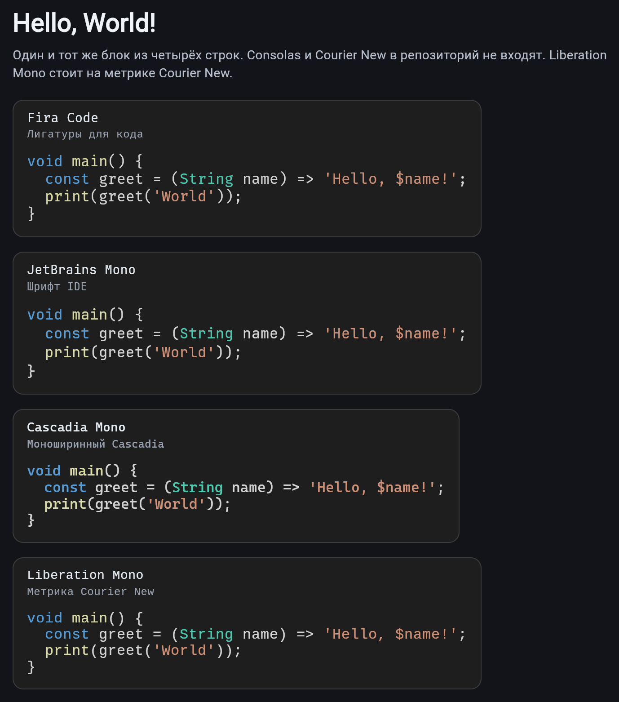
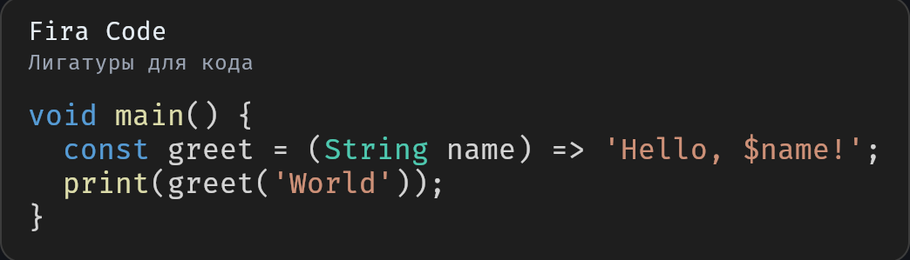
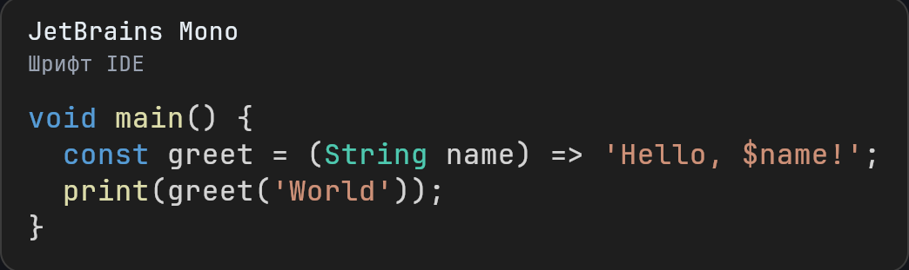
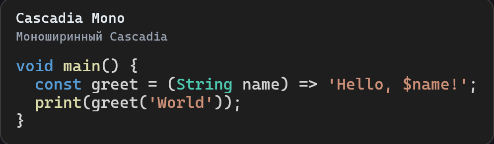
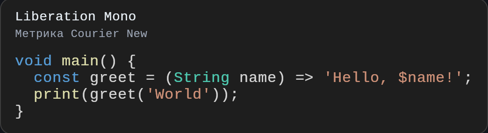

# atmos_tiled_text_renderer

GPU-accelerated monospace text. Glyphs are baked into one `ui.Image`, and each frame is a single `Canvas.drawAtlas` call.

Русский: [README_RU.md](README_RU.md).

`AtlasTextPainter` draws the frame: cell backgrounds, then one `Canvas.drawAtlas` over already flat `FlattenedLineCache` lines.

## Install

```yaml
dependencies:
  atmos_tiled_text_renderer: ^0.1.1
```

The lower bound is Flutter **3.16.9** (Dart 3.2.6).

## Quick start

The atlas is baked when the device pixel ratio changes, not on every frame. Tokenize a line once and pass the painter an already flat cache.

```dart
import 'package:atmos_tiled_text_renderer/atmos_tiled_text_renderer.dart';
import 'package:flutter/material.dart';

final manager = AtlasManager(
  fontFamily: 'monospace',
  logicalFontSize: 16,
);

Future<void> prepare(double devicePixelRatio) {
  return manager.updateDpr(devicePixelRatio, defaultCodeLigatures);
}

final lines = <FlattenedLineCache>[
  FlattenedLineCache.fromSpan(
    const AtlasTextSpan(
      text: 'void main() {}',
      style: AtlasTextStyle(color: Color(0xFFD4D4D4)),
    ),
    defaultCodeLigatures,
  ),
];

Widget frame() {
  return CustomPaint(
    painter: AtlasTextPainter(
      atlasManager: manager,
      visibleLines: lines,
    ),
  );
}
```

`manager.dispose()` releases the texture when the widget no longer needs it.

## Example

`example/` draws the same four-line hello world in Fira Code, JetBrains Mono, Cascadia Mono, and Liberation Mono. Liberation Mono matches Courier New metrics. Consolas and Courier New themselves are not in the repository.

The same frames are documented in [`example/README.md`](example/README.md).

<p>
  
</p>

<p>
  
</p>

<p>
  
</p>

<p>
  
</p>

<p>
  
</p>

```bash
cd example
flutter run -d chrome
```

`Canvas.drawAtlas` does not draw the atlas on Flutter's HTML renderer. Build the web example with CanvasKit:

```bash
cd example
flutter build web --release --web-renderer canvaskit --no-web-resources-cdn --pwa-strategy none
```

## Text model

`AtlasTextSpan` follows the `TextSpan` tree: a leaf stores a string, a node stores children. `AtlasTextStyle` carries optional text and background colors. `null` means "inherit".

`flattenWithLigatures` walks the tree once and returns a flat `List<AtlasGlyph>`. Consecutive characters of one leaf join into a wide glyph (`==`, `!=`, `->`) when that sequence is in the ligature list. A span boundary breaks the join even when the style matches. Each glyph keeps `sourceSpan`, a reference to its leaf for hit testing.

Tokenization is cached in `FlattenedLineCache` and is not repeated per frame. A line's `charCount` is the sum of glyph widths, so `==` occupies two cells.

## Atlas

`AtlasManager` measures a monospace cell through `ParagraphBuilder` and bakes ASCII 32–126 plus the supplied ligatures.

`updateDpr` multiplies the font size by the device pixel ratio, measures at that size, then rounds the cell up to whole pixels. At DPR 2 and above the text stays on its own pixel grid instead of being scaled afterwards. The previous `ui.Image` is released with `dispose` once the new texture is ready.

The column grid is a power of two. A cell position is a bit mask:

- column: `index & columnMask`
- row: `index >> columnShift`

Glyphs in the atlas are white. The span color is passed to `drawAtlas` in the `colors` array. `solidRegion` is the white background cell, tinted by the same call, so background and text share one texture and one draw call. Sampling is `FilterQuality.none`.

## License

BSD 3-Clause — see [LICENSE](LICENSE).
