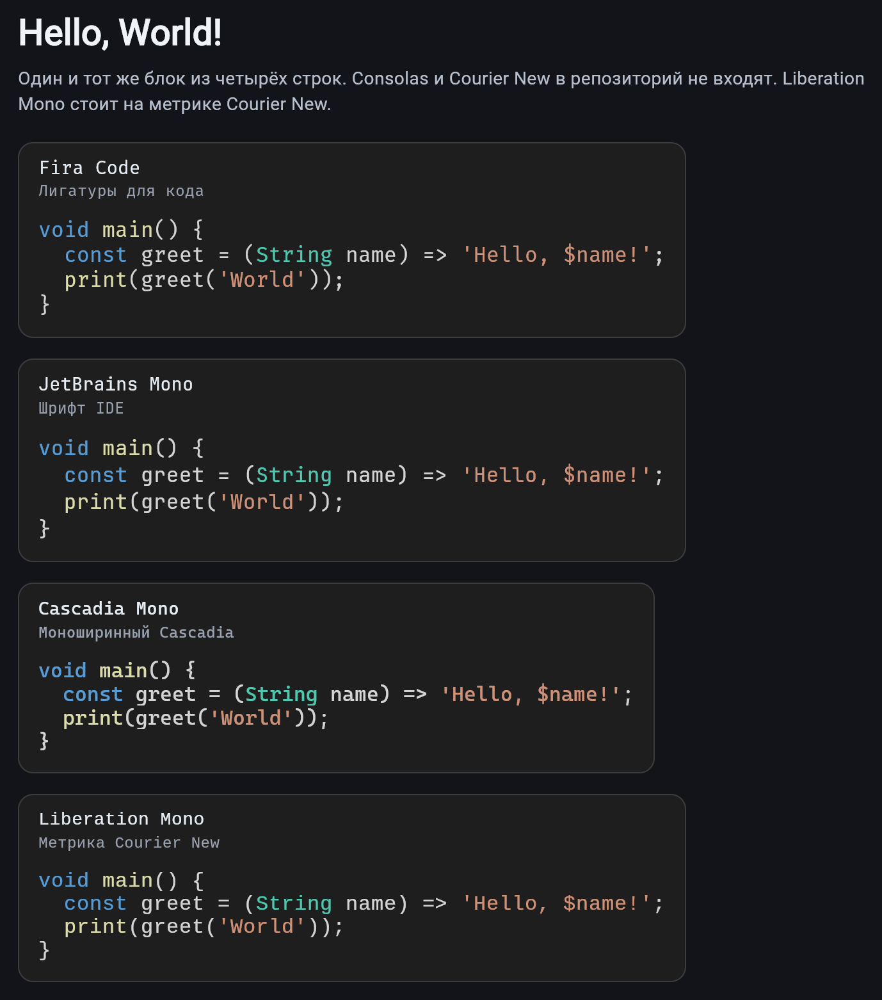
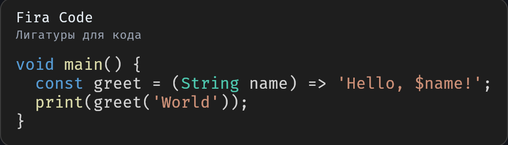
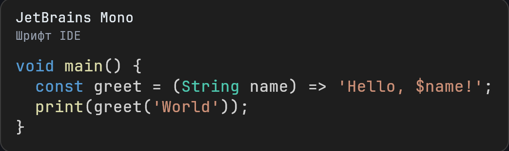
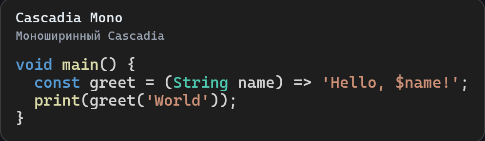
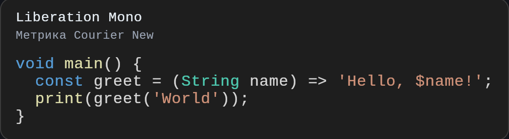

# atmos_tiled_text_renderer

Пакет Flutter для посимвольного рендеринга моноширинного текста через текстурный атлас. Глифы запекаются в одну `ui.Image`, а кадр собирается одним вызовом `Canvas.drawAtlas`.

English: [README.md](README.md).

Кадр рисует `AtlasTextPainter`: подложки ячеек, затем один `Canvas.drawAtlas` по уже плоским строкам `FlattenedLineCache`.

## Установка

```yaml
dependencies:
  atmos_tiled_text_renderer: ^0.1.1
```

Нижняя граница — Flutter **3.16.9** (Dart 3.2.6).

## Быстрый старт

Атлас запекается при смене DPR, а не на каждом кадре. Строку токенизируют один раз и отдают painter уже плоский кэш.

```dart
import 'package:atmos_tiled_text_renderer/atmos_tiled_text_renderer.dart';
import 'package:flutter/material.dart';

final manager = AtlasManager(
  fontFamily: 'monospace',
  logicalFontSize: 16,
);

Future<void> prepare(double devicePixelRatio) {
  return manager.updateDpr(devicePixelRatio, defaultCodeLigatures);
}

final lines = <FlattenedLineCache>[
  FlattenedLineCache.fromSpan(
    const AtlasTextSpan(
      text: 'void main() {}',
      style: AtlasTextStyle(color: Color(0xFFD4D4D4)),
    ),
    defaultCodeLigatures,
  ),
];

Widget frame() {
  return CustomPaint(
    painter: AtlasTextPainter(
      atlasManager: manager,
      visibleLines: lines,
    ),
  );
}
```

`manager.dispose()` отпускает текстуру, когда виджет больше не нужен.

## Пример

В `example/` один и тот же hello world из четырёх строк набран Fira Code, JetBrains Mono, Cascadia Mono и Liberation Mono. Liberation Mono повторяет метрику Courier New. Consolas и сам Courier New в репозиторий не входят.

Те же кадры в [`example/README.md`](example/README.md).

<p>
  
</p>

<p>
  
</p>

<p>
  
</p>

<p>
  
</p>

<p>
  
</p>

```bash
cd example
flutter run -d chrome
```

`Canvas.drawAtlas` не рисует атлас на HTML-рендерере Flutter. Веб-пример нужно собирать на CanvasKit:

```bash
cd example
flutter build web --release --web-renderer canvaskit --no-web-resources-cdn --pwa-strategy none
```

## Модель текста

`AtlasTextSpan` повторяет дерево `TextSpan`: лист хранит строку, узел — детей. `AtlasTextStyle` несёт необязательные цвет текста и фона. `null` означает «наследовать».

`flattenWithLigatures` обходит дерево один раз и возвращает плоский `List<AtlasGlyph>`. Подряд идущие символы одного листа склеиваются в широкий глиф (`==`, `!=`, `->`), если такая последовательность есть в списке лигатур. Граница спана склейку обрывает, даже когда стиль совпадает. У каждого глифа есть `sourceSpan` — ссылка на лист для хит-теста.

Токенизацию кэшируют в `FlattenedLineCache`. На кадр её не повторяют. `charCount` строки — сумма ширин глифов, поэтому `==` занимает две ячейки.

## Атлас

`AtlasManager` измеряет ячейку моноширинного шрифта через `ParagraphBuilder` и запекает ASCII 32–126 плюс переданные лигатуры.

`updateDpr` умножает кегль на device pixel ratio, снимает метрики уже с этого размера и поднимает ячейку до целых пикселей. На DPR 2 и выше текст остаётся в своей пиксельной сетке, а не растягивается потом. Предыдущая `ui.Image` освобождается через `dispose`, когда новая текстура готова.

Сетка колонок — степень двойки. Позиция ячейки считается маской:

- колонка: `index & columnMask`
- строка: `index >> columnShift`

Глифы в атласе белые. Цвет спана передаётся в `drawAtlas` массивом `colors`. `solidRegion` — белая ячейка подложки, её красят тем же вызовом, поэтому фон и текст делят одну текстуру и один draw call. Выборка — `FilterQuality.none`.

## Лицензия

BSD 3-Clause — см. [LICENSE](LICENSE).
