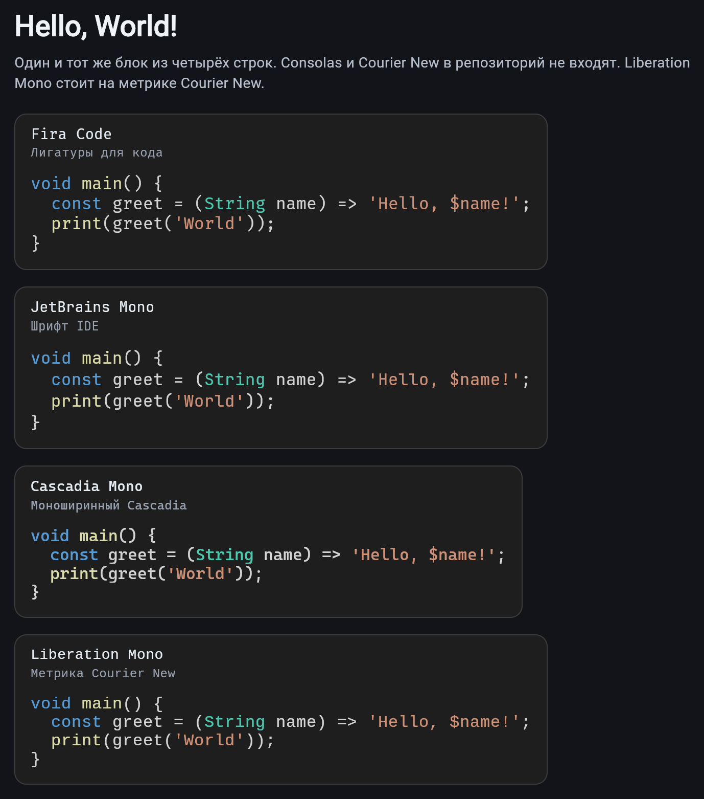
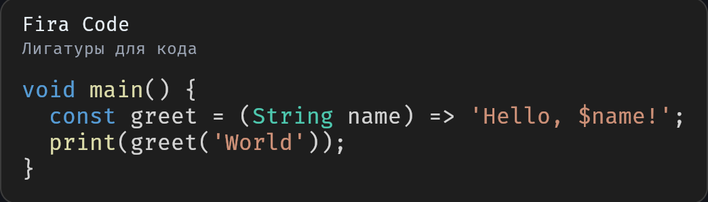
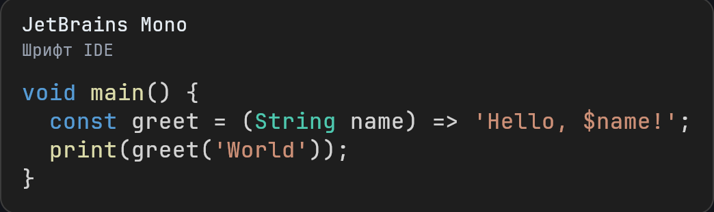
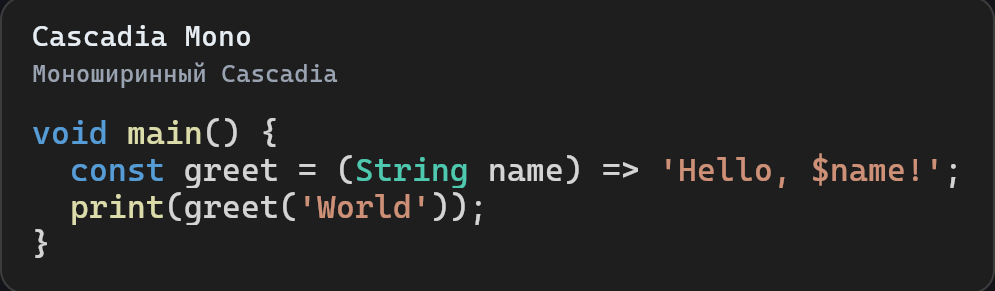
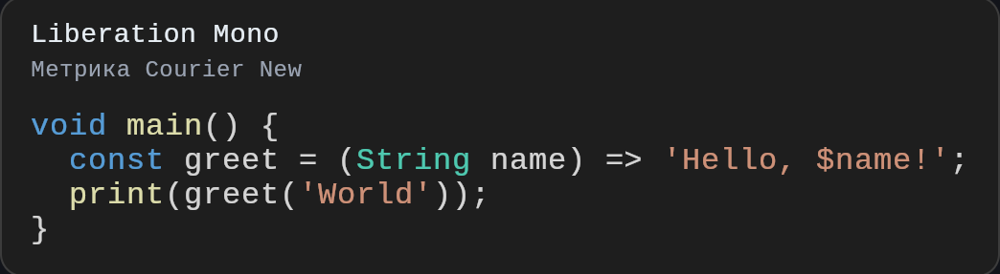

# Hello world

Русский: [README_RU.md](README_RU.md).

Four lines of the same Dart block, drawn from an atlas in Fira Code,
JetBrains Mono, Cascadia Mono, and Liberation Mono. Liberation Mono
matches Courier New metrics. Consolas and Courier New are not in the
repository.

## Screenshots

<p>
  
</p>

<p>
  
</p>

<p>
  
</p>

<p>
  
</p>

<p>
  
</p>

```bash
flutter run -d chrome
```

`Canvas.drawAtlas` does not draw the atlas on Flutter's HTML renderer.
Build the web example with CanvasKit:

```bash
flutter build web --release --web-renderer canvaskit --no-web-resources-cdn --pwa-strategy none
```

## Fonts

Faces under `fonts/` keep their own licenses in `fonts/LICENSES/`.
They are not covered by the package BSD license.

- Fira Code — SIL Open Font License 1.1
- JetBrains Mono — Apache License 2.0
- Cascadia Mono — SIL Open Font License 1.1 (reserved font name Cascadia Code)
- Liberation Mono — SIL Open Font License 1.1
