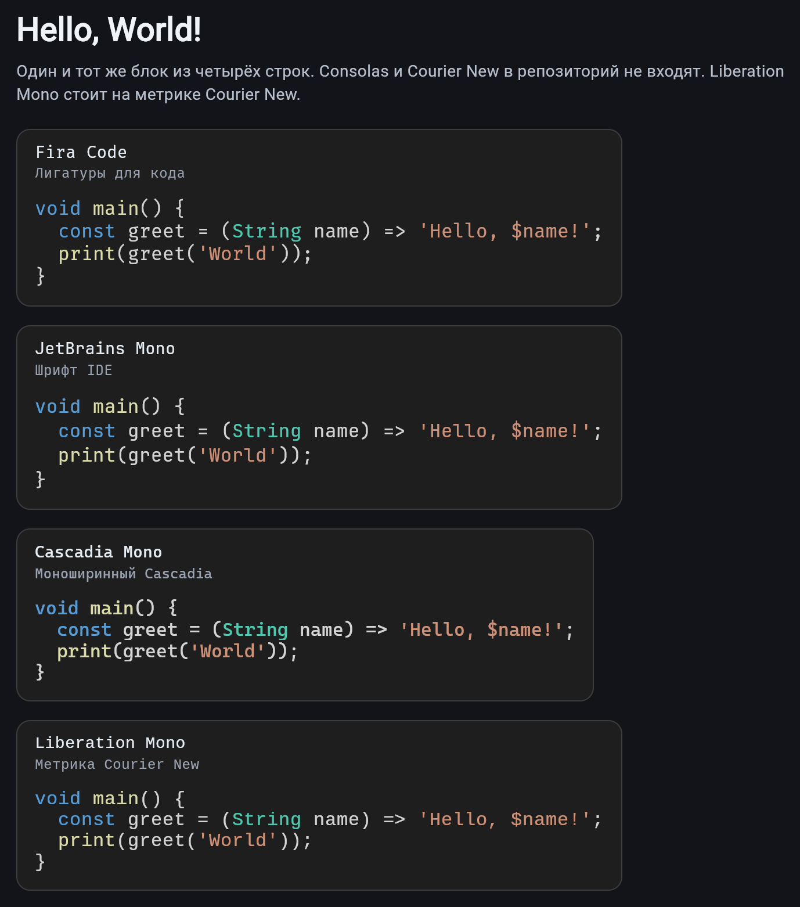
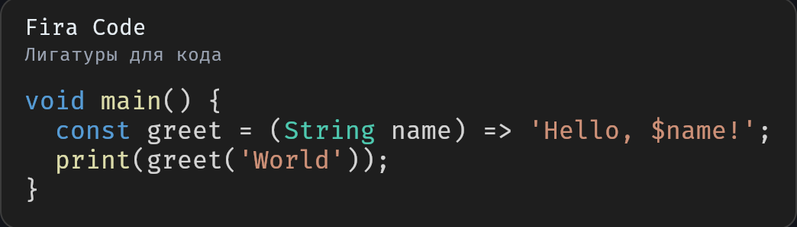
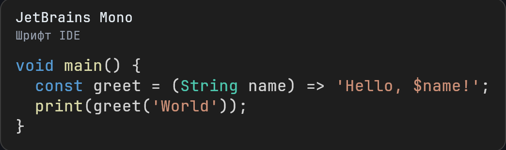
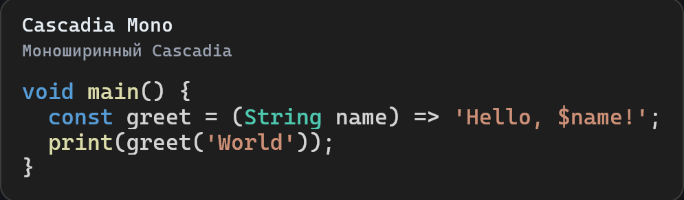
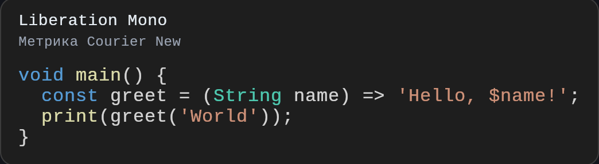

# Hello world

English: [README.md](README.md).

Четыре строки одного и того же Dart-блока, нарисованные атласом
на Fira Code, JetBrains Mono, Cascadia Mono и Liberation Mono.
Liberation Mono повторяет метрику Courier New. Consolas и Courier New
в репозиторий не входят.

## Скриншоты

<p>
  
</p>

<p>
  
</p>

<p>
  
</p>

<p>
  
</p>

<p>
  
</p>

```bash
flutter run -d chrome
```

`Canvas.drawAtlas` не рисует атлас на HTML-рендерере Flutter.
Веб-пример нужно собирать на CanvasKit:

```bash
flutter build web --release --web-renderer canvaskit --no-web-resources-cdn --pwa-strategy none
```

## Шрифты

Файлы в `fonts/` сохраняют собственные лицензии в `fonts/LICENSES/`.
BSD-лицензия пакета на них не распространяется.

- Fira Code — SIL Open Font License 1.1
- JetBrains Mono — Apache License 2.0
- Cascadia Mono — SIL Open Font License 1.1 (зарезервированное имя Cascadia Code)
- Liberation Mono — SIL Open Font License 1.1
